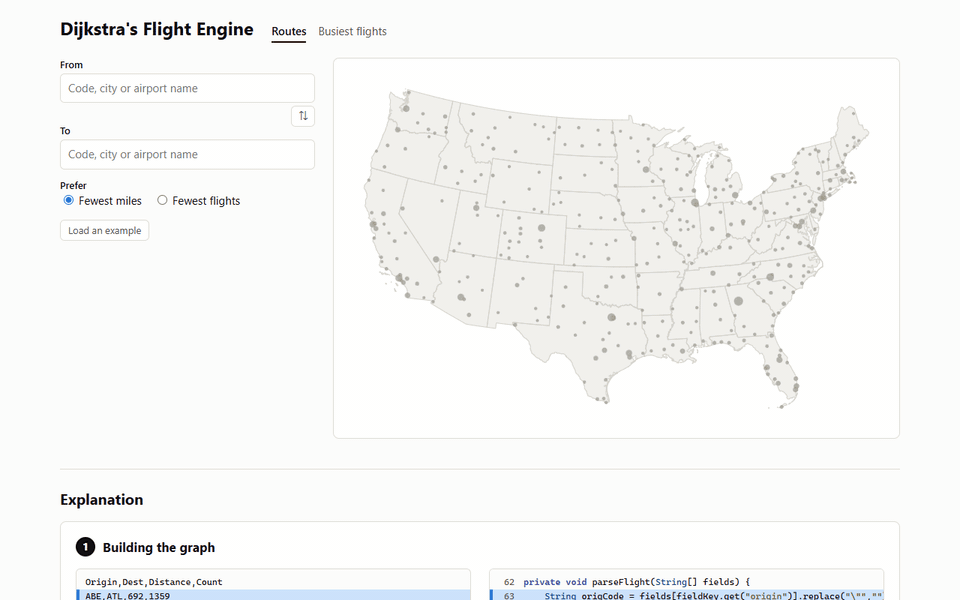
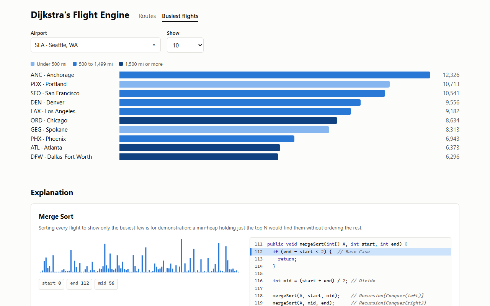

# Dijkstra's Flight Engine

**[Try it live](https://boaxes.github.io/dijkstras-flight-engine/)**



Pick two US airports and it finds the shortest route between them, or the one with the fewest flights, across 416
airports and 11,147 real routes. Then it replays the code that found the answer, line by line, beside the priority
queue and hash table that code was using.

The routing is written in Java and compiled to WebAssembly with [TeaVM](https://teavm.org). It runs in the browser
with no server.



## Run it locally

You need JDK 17 or newer, and Python to serve the files.

```bash
./gradlew site
```

```bash
python -m http.server 8123 --directory build/site
```

Open http://localhost:8123. `./gradlew test` runs the tests.

## Data

- Flights come from the Bureau of Transportation Statistics' DB1B survey, a 10% sample of airline tickets, for
  January to March 2018. `./gradlew buildData -Pdb1b=path/to/DB1BCoupon.csv` collapses a raw 123 MB file to the
  174 KB the page loads.
- Airport names and positions come from [OurAirports](https://ourairports.com/data/), public domain.
- State outlines come from the US Census Bureau through [us-atlas](https://github.com/topojson/us-atlas) (ISC
  licence).
